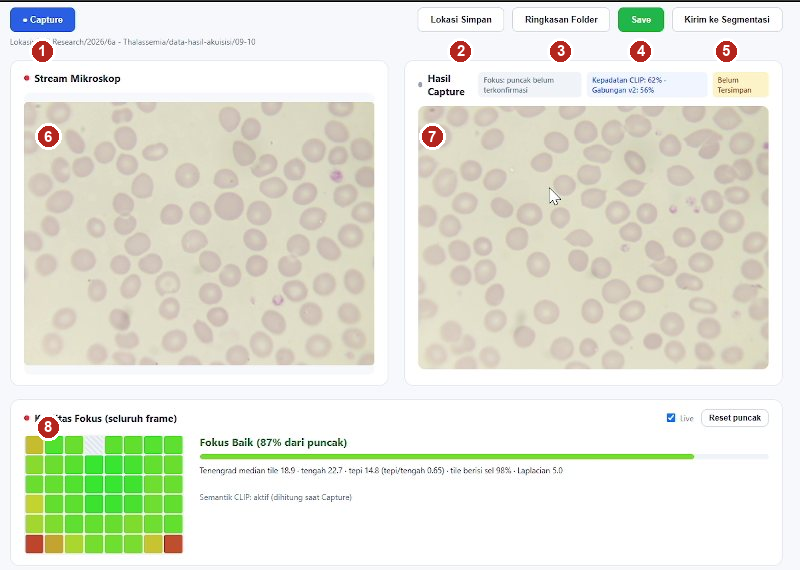
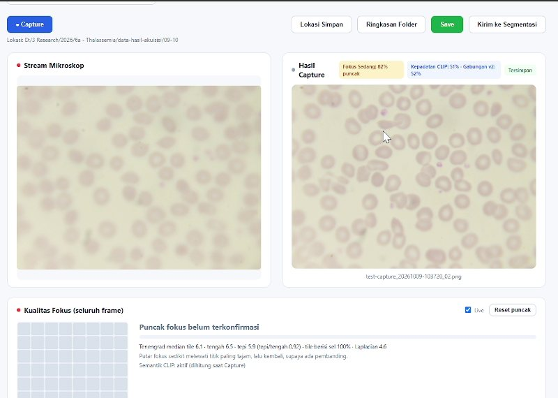
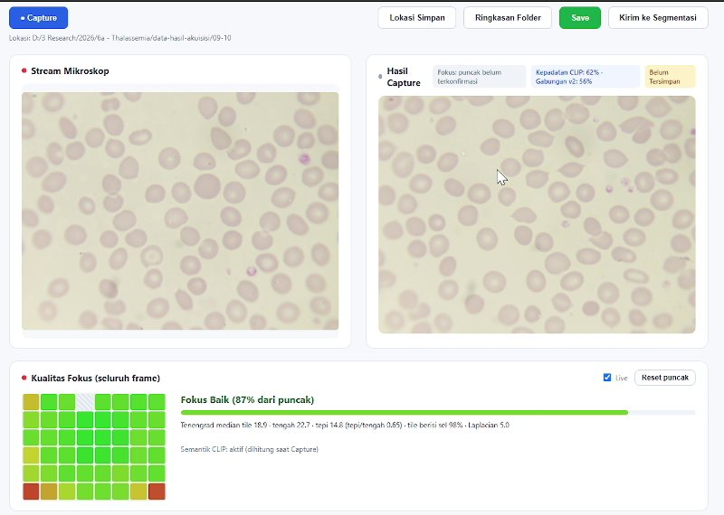
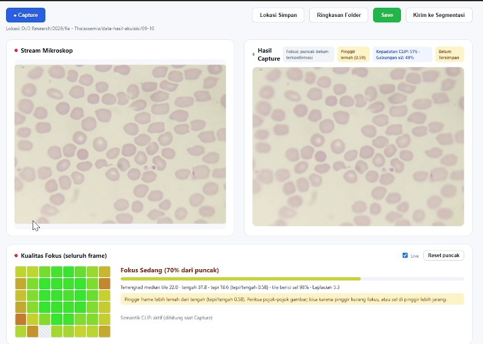
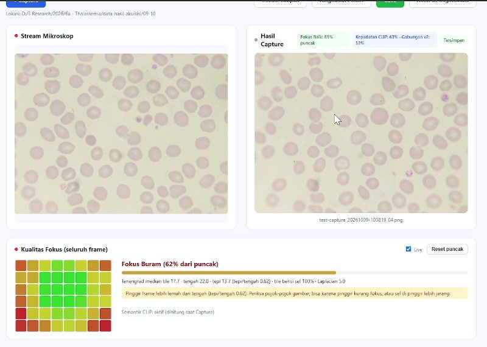
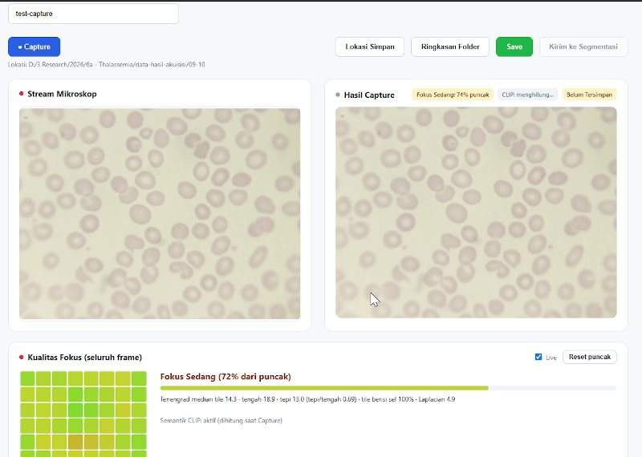
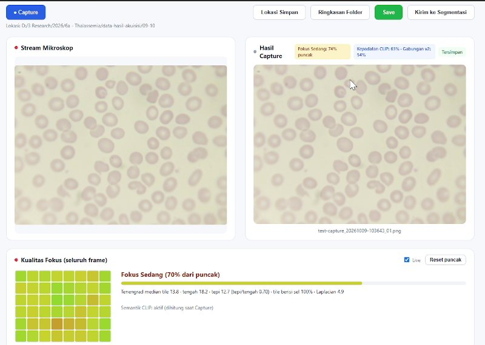

*Riset Talasemia · Universitas Gadjah Mada*

# Panduan aplikasi akuisisi citra apusan darah tepi

Aplikasi web lokal untuk mengambil citra apusan darah tepi dari kamera mikroskop USB, dengan penilaian fokus seluruh frame. Panduan ini berisi alur pemakaian, cara membaca kartu Kualitas Fokus, dan pemecahan masalah umum.

> Versi PDF: [panduan-aplikasi.pdf](panduan-aplikasi.pdf)

[Alur singkat](#alur-singkat) · [Mengenal layar](#mengenal-layar) · [Menjalankan aplikasi](#menjalankan-aplikasi) · [Kamera, ID, lokasi simpan](#kamera-id-pasien-dan-lokasi-simpan) · [Mengatur fokus](#mengatur-fokus) · [Capture](#capture) · [Menyimpan](#menyimpan) · [Pemecahan masalah](#pemecahan-masalah)

## Alur singkat

1. **Hubungkan kamera.** Pilih kamera di TopBar, lalu klik **Hubungkan**.

2. **Isi ID pasien.** Isi inisial atau ID pasien sebelum mengambil gambar.

3. **Pilih lokasi simpan.** Klik **Lokasi Simpan** dan pilih folder tujuan.

4. **Atur fokus.** Putar fokus mikroskop sampai kartu Kualitas Fokus berstatus Baik.

5. **Capture.** Klik **Capture** dan periksa hasilnya di panel Hasil Capture.

6. **Save.** Klik **Save**. File dan baris log tercatat otomatis.

## Mengenal layar

*Layar utama saat fokus Baik. Bagian paling atas halaman (pilihan kamera, resolusi, tombol Hubungkan, ID pasien) tidak ikut terlihat di rekaman demo.*

- **1. Capture**: mengambil gambar diam dari stream.
- **2. Lokasi Simpan**: memilih folder tujuan.
- **3. Ringkasan Folder**: jumlah gambar per pasien di folder itu.
- **4. Save**: menyimpan hasil capture ke folder.
- **5. Kirim ke Segmentasi**: meneruskan gambar ke halaman segmentasi.
- **6. Stream Mikroskop**: tampilan langsung dari kamera.
- **7. Hasil Capture**: gambar yang baru diambil, dengan badge kualitas.
- **8. Kualitas Fokus**: status fokus dan peta tile 8×6.

## Menjalankan aplikasi

### Windows

Persyaratan: Python 3.9 atau lebih baru (centang *Add Python to PATH* saat memasang) dan driver DirectShow kamera. Untuk MiiCam, pasang `MIIDshowSetup.exe`.

Klik dua kali `run.bat`. Browser terbuka ke `http://127.0.0.1:5000`. Untuk berhenti, tutup jendela hitam berjudul *ThalassemiaWebApp - Server*.

### Ubuntu atau Linux

Pasang paket: `sudo apt install python3-venv python3-tk v4l-utils`.

Jalankan `chmod +x run.sh` sekali, lalu `./run.sh`. Browser terbuka ke alamat yang sama. Tekan <kbd>Ctrl</kbd>+<kbd>C</kbd> di terminal untuk berhenti.

Skrip pertama kali membuat virtual environment dan memasang pustaka dari `requirements.txt`, jadi butuh internet pada awalnya.

## Kamera, ID pasien, dan lokasi simpan

1. Colokkan kamera mikroskop USB dan pastikan sistem operasi sudah mengenalinya (Windows: Device Manager; Linux: `v4l2-ctl --list-devices`).

2. Di TopBar, pilih nama kamera di dropdown. Resolusi boleh dibiarkan *Bawaan kamera* (resolusi maksimum). Klik **Hubungkan**. Resolusi yang benar-benar dipakai tampil di sebelah status *Aktif*.

3. Isi **Inisial/ID Pasien**. ID ini menjadi awal nama file yang tersimpan.

4. Klik **Lokasi Simpan** dan pilih folder tujuan lewat dialog folder bawaan sistem. Panel **Ringkasan Folder** menampilkan jumlah gambar per pasien di folder itu.

> **Screenshot belum tersedia.** Bagian TopBar (kamera, resolusi, Hubungkan, ID pasien, Lokasi Simpan) tidak ada di rekaman demo 9 Oktober 2026. Tambahkan tangkapan layar setelah ada rekaman yang menampilkannya.

> **Catatan.** Kamera USB biasanya hanya bisa dipakai satu aplikasi. Tutup OBS Studio atau aplikasi viewer bawaan kamera sebelum menghubungkan.

## Mengatur fokus

Dokter menganotasi citra penuh, jadi yang dinilai adalah seluruh frame termasuk pinggir. Setiap tile pada peta 8×6 dibandingkan dengan puncak tile itu sendiri, bukan dengan nilai mutlak. Hijau berarti dekat puncak, merah berarti jauh.

### Konfirmasi puncak fokus dulu

*Setelah lapang pandang berganti, kartu menampilkan Puncak fokus belum terkonfirmasi dan peta tile abu-abu.*

*Setelah puncak terkonfirmasi: Fokus Baik (87% dari puncak), peta tile hijau merata.*

1. Letakkan lapang pandang yang akan diambil.

2. Putar fokus **sedikit melewati titik paling tajam, lalu kembali**. Tanpa pembanding, tiap frame otomatis menjadi puncak baru, sehingga kartu menunggu konfirmasi.

3. Baca status di kartu. Saat berstatus Baik, lanjut ke Capture.

### Arti status

| Status | Arti | Yang dilakukan |
|----|----|----|
| **Baik** | 85% atau lebih dari puncak. | Lanjut Capture. |
| **Sedang** | 65% sampai di bawah 85% dari puncak. | Putar fokus perlahan sampai lebih tajam. Capture tetap bisa dilakukan. |
| **Buram** | Di bawah 65% dari puncak. | Perbaiki fokus. Saat Save, aplikasi meminta konfirmasi dulu (peringatan, tidak memblokir). |
| **Puncak belum terkonfirmasi** | Belum ada pembanding. | Putar fokus melewati titik tajam lalu kembali. |
| **Pinggir lemah** | Rasio tepi/tengah di bawah 0,65. | Periksa pojok gambar. Tidak mengubah status. |

*Status Sedang (70%) dengan peringatan kuning di bawahnya.*

*Status Buram (62%): tile tengah hijau, sudut merah. Peringatan menyebut tepi/tengah 0,62.*

> **Catatan.** Peringatan pinggir lemah muncul walau fokus tengah bagus. Penyebabnya bisa preparat atau kamera miring, atau sel yang lebih jarang di pinggir. Ambang status (0,85 dan 0,65) masih heuristik dan belum dikalibrasi dengan penilaian dokter.

Kartu bisa dimatikan lewat kotak **Live** untuk menghemat CPU (analisis tetap berjalan saat Capture). Tombol **Reset puncak** mengosongkan referensi secara manual; referensi juga direset otomatis saat lapang pandang berganti.

## Capture

*Setelah Capture, gambar diam muncul di Hasil Capture dengan badge di atasnya.*

1. Pastikan panel Stream bergerak. Kalau diam, semua hasil capture akan identik.

2. Klik **Capture**. Gambar muncul di panel **Hasil Capture**.

3. Baca badge di atas gambar: **Fokus Sedang 72% puncak** menurut penilaian fokus, badge biru untuk kepadatan sel (CLIP), dan **Belum Tersimpan** sampai Anda menekan Save.

4. Kalau belum pas, klik Capture lagi untuk mengambil ulang.

Badge fokus pada Hasil Capture memakai penilaian saat tombol ditekan. Skor CLIP (kepadatan sel) nonaktif secara default dan diaktifkan lewat `run-clip.bat`; pada rekaman demo CLIP aktif. Skor ini hanya dihitung saat Capture dan berfungsi sebagai informasi, belum divalidasi dengan label dokter.

## Menyimpan

1. Klik **Save**. Kalau statusnya Buram, aplikasi meminta konfirmasi dulu.

2. Badge berubah menjadi **Tersimpan** dan nama file muncul di bawah gambar.

*Setelah Save: badge hijau Tersimpan dan nama file di bawah gambar.*

Format nama file: `id-pasien_YYYYMMDD-HHMMSS_NN.png`, misalnya `test-capture_20261009-103842_01.png`. Metadata setiap capture (waktu, ID pasien, nama file, iterasi, kamera, resolusi, skor fokus) ditambahkan ke `capture_log.csv` di folder yang sama.

> **Screenshot belum tersedia.** Dialog Lokasi Simpan, panel Ringkasan Folder, dan galeri riwayat tidak ada di rekaman demo. Setelah Save, gambar masuk ke galeri di bagian bawah halaman. Klik gambar kecil untuk pratinjau: klik gambar besar untuk zoom 100%, panah kiri/kanan untuk pindah gambar, <kbd>Esc</kbd> untuk menutup.

## Pemecahan masalah

### Kamera tidak muncul di dropdown

- Windows: pastikan driver DirectShow terpasang dan kamera terbaca di Device Manager.
- Linux: jalankan `v4l2-ctl --list-devices`. Kalau kamera tidak muncul, coba kabel atau port USB lain.
- Tutup aplikasi lain yang memakai kamera (OBS Studio, viewer bawaan).
- Jalankan `python check_cameras.py` dengan venv aktif untuk melihat status tiap kamera.

### Semua gambar hasil capture identik

Panel Stream kemungkinan berhenti (misalnya tab browser diminimalkan) sehingga video membeku. Pastikan stream bergerak sebelum Capture.

### Dialog Lokasi Simpan tidak muncul (Linux)

Pasang `sudo apt install python3-tk`, lalu jalankan ulang `run.sh`.

### Kamera tidak bisa dibuka, Permission denied (Linux)

Tambahkan pengguna ke grup video: `sudo usermod -aG video $USER`, lalu keluar dan masuk lagi.

### MiiCam terbaca di lsusb tetapi tidak di v4l2-ctl

Kasus ini memakai SDK vendor ToupCam. Pastikan udev rule terpasang (`ls /etc/udev/rules.d/99-toupcam.rules`) dan kamera sudah dicabut-colok setelahnya. Pesan error di konsol server (`[DEBUG] ToupCam ...`) biasanya menunjukkan penyebabnya.

*Sumber: README aplikasi dan rekaman demo 9 Oktober 2026 (tangkapan layar diambil dari rekaman itu). Bagian yang bertanda "Screenshot belum tersedia" ditulis dari README, belum dari rekaman.*
